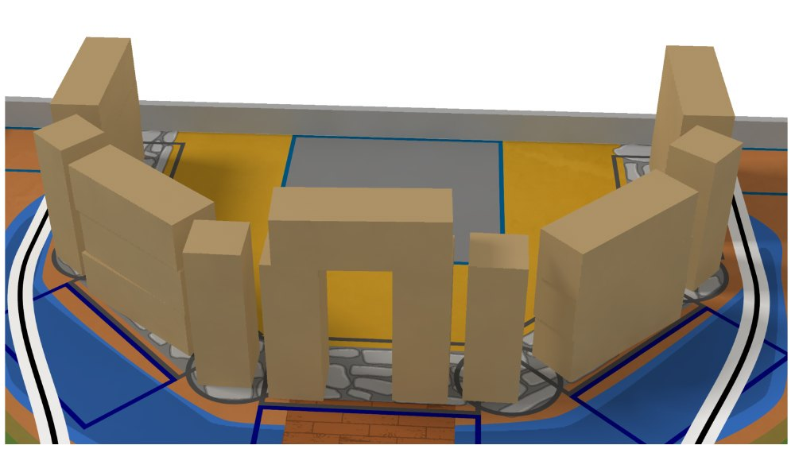

La **version officielle 1.0 du règlement Eurobot 2027** vient d'être publiée par Planète Sciences. Le thème de cette 34e édition : **la légende du roi Arthur et de Camelot**. Les robots se prennent pour des chevaliers, chaque équipe possède « le vrai » Graal, et il va falloir le mettre à l'abri derrière les remparts de son château !

### La table

L'aire de jeu reste un plateau de 3 m × 2 m. Chaque équipe dispose d'un **château** : une cour avec la salle du trône (zone de départ et d'arrivée du robot), entourée de remparts et de douves. Sur la table, **30 pierres** (des boîtes en carton de 320 × 110 × 110 mm, marquées d'un tag ArUco) attendent dans des carrières, empilées par trois.

### Les quatre actions

- **Construction de Camelot** : ramasser les pierres et bâtir le château en suivant les plans. Un **mur** se fait avec 3 pierres couchées et empilées, une **tour** avec 1 pierre debout, et une **porte** avec 2 pierres debout surmontées d'un linteau. Chaque pierre posée rapporte 1 point, un mur ou une tour +5, et la porte, unique, +20.
- **Il n'y en a qu'un, et c'est le mien !** : chaque équipe fabrique son propre Graal. Pendant le match, le robot doit le hisser le plus haut possible dans le château : sur une pierre, une construction, ou même sur son propre toit. 5 points s'il est dans le château, puis 5 points par niveau, jusqu'à 4.
- **Le retour du roi** : à la fin du match, le robot principal rentre dans sa salle du trône (5 points s'il y est en partie, 10 s'il y est entièrement).
- **À l'assaut !** : à partir de la 85e seconde, les PAMI (nos « chevaliers ») partent attaquer le château adverse. Ils marquent 5 points par douve adverse occupée et 5 points s'ils attaquent un PAMI adverse. Les robots peuvent aussi **bombarder** la cour adverse avec des boulets en mousse : 5 points pour un boulet, +15 dès trois.

Comme chaque année, toutes les actions sont indépendantes et aucune n'est obligatoire : le règlement recommande de viser des systèmes simples et fiables sur un nombre limité d'actions.

### Calculez vos points

Pour préparer votre stratégie ou vérifier un match, nous avons mis en ligne un **[calculateur de points 2027](calculateur.html)** : quelques touches suffisent pour obtenir votre score.

Le règlement complet est disponible sur [eurobot.org](https://www.eurobot.org/) et les questions se posent sur la [FAQ officielle](https://www.eurobot.org/faq/). Rendez-vous sur la table !

*Images : règlement Eurobot 2027, Planète Sciences.*
